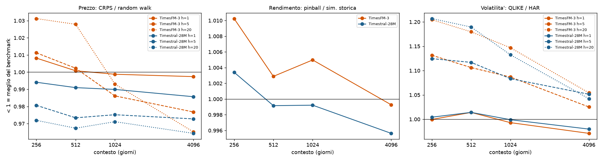

# Controlli di robustezza del pilota

## 1. Spot vs futures (energia, 5 coppie)

Stessi compiti e protocollo del pilota sui prezzi spot FRED/EIA, che non hanno roll dei contratti. Valori < 1 = meglio del benchmark; media geometrica sulle 5 coppie.

| modello | CRPS/RW h=1 fut | CRPS/RW h=1 spot | CRPS/RW h=5 fut | CRPS/RW h=5 spot | CRPS/RW h=20 fut | CRPS/RW h=20 spot | pinball/SS fut | pinball/SS spot |
|---|---|---|---|---|---|---|---|---|
| GARCH-t |  |  |  |  |  |  | 0.988 | 0.986 |
| TimesFM-3 | 0.978 | 0.953 | 0.982 | 0.923 | 1.003 | 0.942 | 0.995 | 0.985 |
| Timestral-209M | 0.970 | 0.946 | 0.964 | 0.916 | 0.962 | 0.913 | 0.990 | 0.983 |
| Timestral-28M | 0.971 | 0.956 | 0.966 | 0.918 | 0.966 | 0.918 | 0.991 | 0.985 |

**Asset con differenza significativa (DM + Benjamini-Hochberg al 10%, su 5)**

| compito | h | modello | meglio (BH) fut | meglio (BH) spot | peggio (BH) fut | peggio (BH) spot |
|---|---|---|---|---|---|---|
| prezzo | 1 | TimesFM-3 | 4 | 4 | 0 | 0 |
| prezzo | 1 | Timestral-209M | 5 | 5 | 0 | 0 |
| prezzo | 1 | Timestral-28M | 5 | 4 | 0 | 0 |
| prezzo | 5 | TimesFM-3 | 0 | 0 | 0 | 0 |
| prezzo | 5 | Timestral-209M | 4 | 5 | 0 | 0 |
| prezzo | 5 | Timestral-28M | 4 | 5 | 0 | 0 |
| prezzo | 20 | TimesFM-3 | 0 | 0 | 0 | 0 |
| prezzo | 20 | Timestral-209M | 2 | 0 | 0 | 0 |
| prezzo | 20 | Timestral-28M | 0 | 0 | 0 | 0 |
| rendimento | 1 | GARCH-t | 4 | 4 | 0 | 0 |
| rendimento | 1 | TimesFM-3 | 0 | 1 | 0 | 0 |
| rendimento | 1 | Timestral-209M | 2 | 3 | 0 | 0 |
| rendimento | 1 | Timestral-28M | 0 | 1 | 0 | 0 |

**Dettaglio per coppia**

| coppia | modello | CRPS/RW h=1 fut | CRPS/RW h=1 spot | CRPS/RW h=5 fut | CRPS/RW h=5 spot | CRPS/RW h=20 fut | CRPS/RW h=20 spot | pinball/SS fut | pinball/SS spot |
|---|---|---|---|---|---|---|---|---|---|
| Benzina | GARCH-t |  |  |  |  |  |  | 0.990 | 0.988 |
| Benzina | TimesFM-3 | 0.985 | 0.982 | 0.982 | 0.977 | 1.038 | 0.985 | 0.996 | 0.994 |
| Benzina | Timestral-209M | 0.973 | 0.971 | 0.963 | 0.972 | 0.947 | 0.953 | 0.992 | 0.990 |
| Benzina | Timestral-28M | 0.973 | 0.970 | 0.966 | 0.972 | 0.957 | 0.967 | 0.994 | 0.995 |
| Brent | GARCH-t |  |  |  |  |  |  | 0.977 | 0.980 |
| Brent | TimesFM-3 | 0.972 | 0.967 | 0.982 | 0.965 | 1.020 | 1.008 | 0.990 | 0.992 |
| Brent | Timestral-209M | 0.968 | 0.962 | 0.961 | 0.958 | 0.973 | 0.972 | 0.983 | 0.982 |
| Brent | Timestral-28M | 0.965 | 0.961 | 0.963 | 0.958 | 0.975 | 0.977 | 0.986 | 0.985 |
| Gas naturale | GARCH-t |  |  |  |  |  |  | 1.010 | 0.988 |
| Gas naturale | TimesFM-3 | 0.985 | 0.871 | 0.985 | 0.748 | 0.962 | 0.751 | 1.000 | 0.949 |
| Gas naturale | Timestral-209M | 0.976 | 0.864 | 0.964 | 0.752 | 0.939 | 0.738 | 0.997 | 0.962 |
| Gas naturale | Timestral-28M | 0.981 | 0.910 | 0.969 | 0.758 | 0.946 | 0.745 | 1.000 | 0.963 |
| Gasolio | GARCH-t |  |  |  |  |  |  | 0.980 | 0.988 |
| Gasolio | TimesFM-3 | 0.968 | 0.970 | 1.000 | 0.981 | 0.999 | 0.989 | 0.994 | 0.992 |
| Gasolio | Timestral-209M | 0.964 | 0.965 | 0.983 | 0.968 | 0.984 | 0.965 | 0.987 | 0.991 |
| Gasolio | Timestral-28M | 0.965 | 0.967 | 0.984 | 0.969 | 0.983 | 0.960 | 0.989 | 0.990 |
| WTI | GARCH-t |  |  |  |  |  |  | 0.984 | 0.985 |
| WTI | TimesFM-3 | 0.978 | 0.982 | 0.961 | 0.966 | 1.000 | 1.006 | 0.996 | 0.998 |
| WTI | Timestral-209M | 0.971 | 0.973 | 0.951 | 0.953 | 0.969 | 0.961 | 0.990 | 0.991 |
| WTI | Timestral-28M | 0.970 | 0.975 | 0.950 | 0.955 | 0.971 | 0.966 | 0.989 | 0.992 |

## 2. Sensibilita' alla lunghezza del contesto (15 futures)

Contesto di 256, 512, 1024 e 4096 giorni, una previsione ogni 5 giorni dal 2024. Valori < 1 = meglio del benchmark (media geometrica sugli asset). Con 4096 giorni il Brent (dati dal 07/2007) perde le prime ~15 origini del test.

| modello | contesto | CRPS/RW h=1 | CRPS/RW h=5 | CRPS/RW h=20 | pinball/SS | QLIKE/HAR h=1 | QLIKE/HAR h=5 | QLIKE/HAR h=20 |
|---|---|---|---|---|---|---|---|---|
| TimesFM-3 | 256 | 1.008 | 1.011 | 1.031 | 1.010 | 1.000 | 1.132 | 1.205 |
| TimesFM-3 | 512 | 1.001 | 1.002 | 1.028 | 1.003 | 1.014 | 1.106 | 1.180 |
| TimesFM-3 | 1024 | 0.999 | 0.986 | 0.993 | 1.005 | 0.993 | 1.087 | 1.147 |
| TimesFM-3 | 4096 | 0.997 | 0.977 | 0.965 | 0.999 | 0.971 | 1.025 | 1.054 |
| Timestral-28M | 256 | 0.994 | 0.981 | 0.972 | 1.003 | 1.004 | 1.125 | 1.207 |
| Timestral-28M | 512 | 0.991 | 0.973 | 0.967 | 0.999 | 1.014 | 1.117 | 1.189 |
| Timestral-28M | 1024 | 0.990 | 0.975 | 0.971 | 0.999 | 0.999 | 1.083 | 1.132 |
| Timestral-28M | 4096 | 0.986 | 0.973 | 0.964 | 0.996 | 0.980 | 1.051 | 1.042 |

